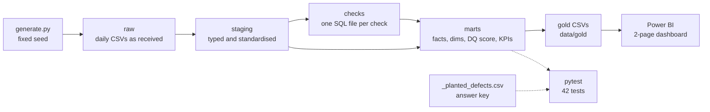

# BrewTower

A practice data-quality pipeline for a beer distributor, with delivery KPIs and a Power BI dashboard.
Python orchestrates, SQL in DuckDB does the work, and Power BI reads the result as CSV.

> **All data is synthetic.** `src/brewtower/generate.py` simulates six months (2026-03-01 to 2026-08-31) with a
> fixed seed. The defects are planted on purpose and listed in an answer key, so I can prove that the checks
> catch every one of them and flag nothing else.

## The problem

A distributor's delivery numbers come from four systems: ERP orders, warehouse (WMS) shipments, carrier tracking
and master data. Each system has its own formats and its own failures: empty fields, impossible dates, codes nobody
recognises, feeds that arrive late or not at all. If those records go straight into an on-time-delivery report,
the KPI is wrong and nobody can tell why. This project checks every record against three questions
(**is it complete, is it valid, is it fresh?**), keeps a reason for every failure, scores each source per day,
and only then computes OTD and OTIF.

The simulated business: 3 breweries supply 6 distribution centres (DCs) in Czechia, which deliver 40 SKUs
(10 beer brands x 4 pack types) to 400 bars, retailers and wholesalers through 4 carriers.
16,835 orders, 46,201 order lines, 36,504 tracking events.

## Architecture



| Layer | What happens | Where |
|---|---|---|
| raw | Daily CSVs loaded as text, exactly as received. `raw.files` lists which files arrived. | `data/raw/` (generated, not committed) |
| staging | Types and formats decoded: SAP dates and quantities, padded IDs, upper-case codes. Nothing removed. | [`sql/staging/`](sql/staging) |
| checks | One SELECT per check. Each returns the failing records with source, check name, dimension and reason. | [`sql/checks/`](sql/checks) |
| marts | Star schema, `dq_issues` (all failures), `dq_score_daily`, `delivery_kpis`. | [`sql/marts/`](sql/marts) |
| gold | The marts exported as CSV for Power BI. Re-runs give byte-identical files. | [`data/gold/`](data/gold) |

[`src/brewtower/pipeline.py`](src/brewtower/pipeline.py) runs the SQL files in name order. The file name is the
table name, so `sql/checks/late_file.sql` becomes `checks.late_file`. Every run drops and rebuilds all schemas.

## Sources

| Source | Imitates | Grain | Normal quirks that staging fixes (not flagged) |
|---|---|---|---|
| `erp_orders` | SAP sales order export | one order line | SAP field names (`VBELN`, `KUNNR`, `MATNR`, `KWMENG`, `VDATU`, `WERKS`), dates as `YYYYMMDD`, `00000000` as an empty date, quantities as `12.000` and negatives as `5.000-`, customer IDs padded to 10 digits |
| `wms_shipments` | warehouse picking system | one shipped order line | order IDs without padding, DC codes like `" cz01"` |
| `carrier_tracking` | carrier status feed | one tracking event (`PICKED_UP`, `IN_TRANSIT`, `DELIVERED`) | one carrier sends lower-case statuses |
| `master_data` | MDM extract: customers, products, DCs, carriers | one row per entity per file | full load on day 1, then daily deltas; a changed row in a later file is an update, not a duplicate |

Each daily file carries `extracted_at`, the time the export job ran. The SLA is 06:00 the next morning.

## Checks and planted defects

Every failing record goes to `dq_issues` with its source, date, record ID, check name, dimension and a reason in
plain words (for example `VDATU 20260231 is not a calendar date`). Flagged records stay in the fact tables with
`has_dq_issue = true`; nothing is dropped.

| Check | Dimension | Source | What it flags | Planted | Caught |
|---|---|---|---|---:|---:|
| `missing_customer_id` | completeness | erp_orders | `KUNNR` empty | 152 | 152 |
| `missing_promised_date` | completeness | erp_orders | `VDATU` empty or `00000000` | 181 | 181 |
| `missing_carrier_id` | completeness | wms_shipments | shipment line without a carrier | 92 | 92 |
| `missing_delivered_qty` | completeness | carrier_tracking | `DELIVERED` event without a quantity | 97 | 97 |
| `missing_dc_code` | completeness | master_data | customer without a DC | 4 | 4 |
| `nonpositive_qty` | validity | erp_orders | quantity 0 or negative | 139 | 139 |
| `nonpositive_qty` | validity | wms_shipments | shipped quantity 0 or negative | 92 | 92 |
| `unknown_sku` | validity | erp_orders | `MATNR` not in the product master | 92 | 92 |
| `unknown_customer` | validity | erp_orders | `KUNNR` not in the customer master | 91 | 91 |
| `bad_dc_code` | validity | erp_orders | `WERKS` is not a known DC | 95 | 95 |
| `bad_dc_code` | validity | wms_shipments | DC code is not a known DC | 46 | 46 |
| `invalid_date` | validity | erp_orders | date that is not on the calendar, e.g. `20260231` | 72 | 72 |
| `promised_before_ordered` | validity | erp_orders | promised date before the order date | 67 | 67 |
| `delivered_before_shipped` | validity | carrier_tracking | delivery time earlier than the WMS dispatch time | 49 | 49 |
| `event_after_extraction` | validity | carrier_tracking | event time later than the moment the file was extracted | 16 | 16 |
| `invalid_customer_type` | validity | master_data | type is not bar, retailer or wholesaler | 3 | 3 |
| `duplicate_key` | validity | master_data | same key twice in one file (8 customers, 1 SKU) | 9 | 9 |
| `late_file` | freshness | erp_orders | file extracted after the 06:00 SLA | 3 | 3 |
| `late_file` | freshness | wms_shipments | same | 2 | 2 |
| `late_file` | freshness | carrier_tracking | same | 7 | 7 |
| `late_file` | freshness | master_data | same | 1 | 1 |
| `missing_file` | freshness | carrier_tracking | no file at all for a day (12 to 14 May) | 3 | 3 |
| `late_arriving_record` | freshness | carrier_tracking | event that arrived in a later day's file (backfills on 15 May and 27 Aug) | 1,114 | 1,114 |
| `stale_open_shipment` | freshness | carrier_tracking | shipment still open with no tracking update for more than 48 h at the end of the day | (derived) | 2,857 |
| **Total** | | | | **2,427** | **5,284** |

All 2,427 planted defects are caught with the same source, date, record ID and check name. The only issues not
in the answer key are the 2,857 `stale_open_shipment` rows. They are not planted directly: they are what the two
feed outages cause, and the pipeline works them out day by day. 2,776 of them are Brno shipments in August.

The answer key is `data/raw/_planted_defects.csv` (source, file date, record ID, defect type, dimension, reason).
Header-field defects in the ERP (customer, promised date, DC) are planted per order, so each line of that order
is listed.

## Data-quality score

**Per source, per day, per dimension:** the % of that day's records with no issue in that dimension.
**Overall score** = the mean of the three dimensions. The breakdown is kept next to the score, so
"why is it 87?" always has an answer.

Rules for the edge cases (also written at the top of [`sql/marts/22_dq_score_daily.sql`](sql/marts/22_dq_score_daily.sql)):

- **Late file:** every record in it fails freshness, so that day's freshness is 0.
- **Missing file:** freshness is 0; completeness and validity are empty (nothing to measure), and the score is the
  mean of the dimensions that exist, so it is 0 too.
- **Header-only file** (a quiet day): freshness is 100. The file arrived and there was nothing else to measure.
- **Carrier feed:** the shipments that are open that day are added to the freshness denominator. The stale ones
  fail. That is how a silent feed shows up as a low score even though it sends no bad rows.

**Worked example, carrier_tracking on 2026-05-15.** The feed had been down for three days. The 15 May file brought
716 events, and 15 shipments were open that day, so the freshness denominator is 731. 497 of the events happened on
12 to 14 May, so they are `late_arriving_record`. Freshness = (731 - 497) / 731 = **32.01 %**. Completeness and
validity were both 100 %. Score = (100 + 100 + 32.01) / 3 = **77.34**.

Average daily score over the six months: carrier_tracking 95.57, erp_orders 98.80, master_data 99.45,
wms_shipments 99.48.

## Delivery KPIs

One order is one shipment. KPIs are computed in [`sql/marts/31_fact_deliveries.sql`](sql/marts/31_fact_deliveries.sql).

| Term | Definition |
|---|---|
| `kpi_eligible` | Delivered, has a valid promised date, and no completeness or validity issue on a field the KPI uses (promised date, quantities, the `DELIVERED` event). An unknown customer, SKU or DC does not block it; the order counts under "Unknown". 16,224 of 16,835 orders are eligible: 502 delivered orders are blocked by a data issue and 109 were not delivered by 31 August. |
| On time | delivery date on or before the promised date |
| In full | every line shipped in full **and** the carrier delivered everything that was shipped |
| **OTD %** | on time / eligible |
| **OTIF %** | on time **and** in full / eligible |
| Avg delay (days) | days after the promised date, 0 when on time, averaged over eligible orders |
| `late_cause` | `dc_dispatch_delay` if the shipment left the DC after the promised date, otherwise `carrier_delay` |

Whole period: **OTD 89.21 %, OTIF 80.57 %, in full 90.28 %, average delay 0.20 days**, 1,750 late deliveries
(1,453 carrier delays, 297 DC dispatch delays).

## Findings

The scenarios behind these findings were designed into the generator. What the project shows is that the checks
and KPIs find them, size them and point to the cause without being told where to look.

**1. One carrier causes most late deliveries.** TransBohemia (CR03) carries 30.93 % of eligible shipments but
61.66 % of the late ones (1,079 of 1,750). Its OTD is 78.50 % against 93.61 to 94.53 % for the other three carriers,
and its OTIF is 71.24 % against 83.59 to 85.17 %. Its in-full rate (90.69 %) is the same as the others
(89.39 to 90.44 %), so the problem is transit time, not short deliveries. 987 of its 1,079 late deliveries are
carrier delays.
*What a manager would do:* take the numbers to TransBohemia's next review, and move the most time-critical
Prague and Plzen routes (62.75 % of its volume) to Vltava Freight, which already serves both DCs.

**2. Brno's tracking data went dark in August, not its deliveries.** Moravia Express (CR02), which carries 69.73 %
of Brno's shipments, stopped sending Brno events on 6 August and sent them all at once on 27 August. From 8 August
the open Brno shipments start failing the 48-hour rule: 264 shipments, the longest silence 499 hours.
Carrier-feed freshness averaged 71.47 % in August against 97.61 % in June and 97.09 % in July, with low points of
21.09 % on 23 August and 27.15 % on 27 August, when 617 backfilled events arrived. It was back to 100 % on 28 August.
Brno's August OTD, measured once the data arrived, was 90.27 %. The trucks were fine; the data was missing.
Without the freshness check, those three weeks would look like open orders with no explanation.
*What a manager would do:* add a daily alert on carrier freshness per DC, and put a feed SLA in the carrier contract.

**3. A can shortage in July cut OTIF.** In July, 14.55 % of can (CAN24) order lines were short-shipped
(373 of 2,563), against 2.65 to 3.82 % in the other months. Other pack types stayed at 2.47 to 3.06 %.
Order-level in full fell to 85.08 % (90.91 to 92.39 % in the other months) and OTIF to 75.46 % (81.61 to 82.60 %).
OTD did not move (88.91 %), so this was a stock problem in the DCs, not a transport problem.
*What a manager would do:* raise the July safety stock for cans before next summer and agree an allocation rule
for short weeks.

**4. A three-day carrier outage in May.** No carrier file arrived on 12, 13 or 14 May. Those days score 0 for the
carrier feed. Open shipments went stale (71 by the end of 14 May), and the 15 May backfill scored 77.34 (see the
worked example). The carrier feed's May average fell to 88.46. It is the only source with days at 0, and it has 30
days below 95 over the period; the other sources have 2 to 4 each.
*What a manager would do:* treat a missing carrier file as an incident the same morning, not when the KPI report
looks odd.

## Tests

42 pytest tests, about 70 seconds (most of it is generating six months of data twice).

- **Generator (6):** same seed gives byte-identical files; the answer key has the right schema and values; at
  most one defect per record; the May outage and the Brno gap are really in the files.
- **Pipeline (29):** every planted defect type is caught with the right check and dimension (100 %); no false
  positives (every issue except `stale_open_shipment` is in the answer key); normal quirks are not flagged
  (padded IDs, `" cz01"`, lower-case statuses, renamed customers); no record is dropped; the DQ score is the mean
  of its non-empty dimensions; re-running gives byte-identical gold files.
- **KPIs (7):** a hand-made fixture of 6 orders in [`tests/fixtures/mini_raw/`](tests/fixtures/mini_raw) with
  OTD, OTIF, average delay, late cause and DQ scores worked out by hand in the test comments.

## How to run

Windows PowerShell, Python 3.13:

```powershell
py -3.13 -m venv .venv
.venv\Scripts\Activate.ps1          # if blocked: Set-ExecutionPolicy -Scope CurrentUser RemoteSigned
pip install -r requirements.txt     # also installs this project (-e .)

python -m brewtower.generate        # writes data/raw (same files every run)
python -m brewtower.pipeline        # writes data/gold and prints the catch rate
pytest                              # 42 tests
```

## Dashboard

Screenshots added after the Power BI build. The step-by-step build guide, with the data model, every DAX measure
and the values to expect, is in [`docs/powerbi-guide.md`](docs/powerbi-guide.md).
The colour theme is [`docs/copper-tower-theme.json`](docs/copper-tower-theme.json).

## Repo layout

```
brewtower/
├── src/brewtower/
│   ├── generate.py        synthetic data + answer key
│   ├── pipeline.py        runs the SQL layers in DuckDB, exports gold CSVs
│   └── paths.py           folder locations in one place
├── sql/
│   ├── staging/           9 files: decode and standardise each source
│   ├── checks/            19 files: one per check
│   └── marts/             11 files: dims, facts, dq_issues, dq_score_daily, delivery_kpis
├── data/
│   ├── raw/               generated daily files + _planted_defects.csv (not committed)
│   └── gold/              CSVs for Power BI (committed)
├── tests/                 pytest suite + tests/fixtures/mini_raw
├── docs/                  Power BI guide and theme
├── requirements.txt       pinned versions
└── pyproject.toml
```

## Limitations and next steps

- **The data is synthetic.** The patterns are realistic but designed. The next step is to run the same checks on a
  real or public supply-chain dataset, where I do not know the answers in advance.
- **Full rebuild every run.** Fine for six months of data; a production version would load incrementally.
- **Databricks.** The layers map directly to a bronze/silver/gold medallion setup, and the SQL is mostly portable to
  Spark SQL on Delta tables.
- **Alerting.** A Power Automate flow (or a Databricks job) could send a message when a source's daily score drops
  below a threshold, for example below 95. That would have fired on 12 May, the first day without a carrier
  file, and on 8 August, as soon as the first Brno shipments passed 48 hours without an update.
- **Configurable rules.** The 48-hour rule and the 06:00 SLA are fixed in the SQL; in production they would live in
  a config table per source and per carrier.
